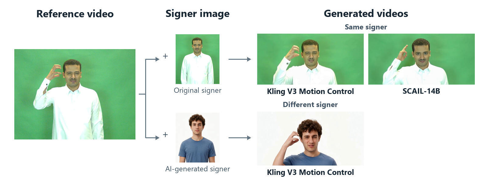
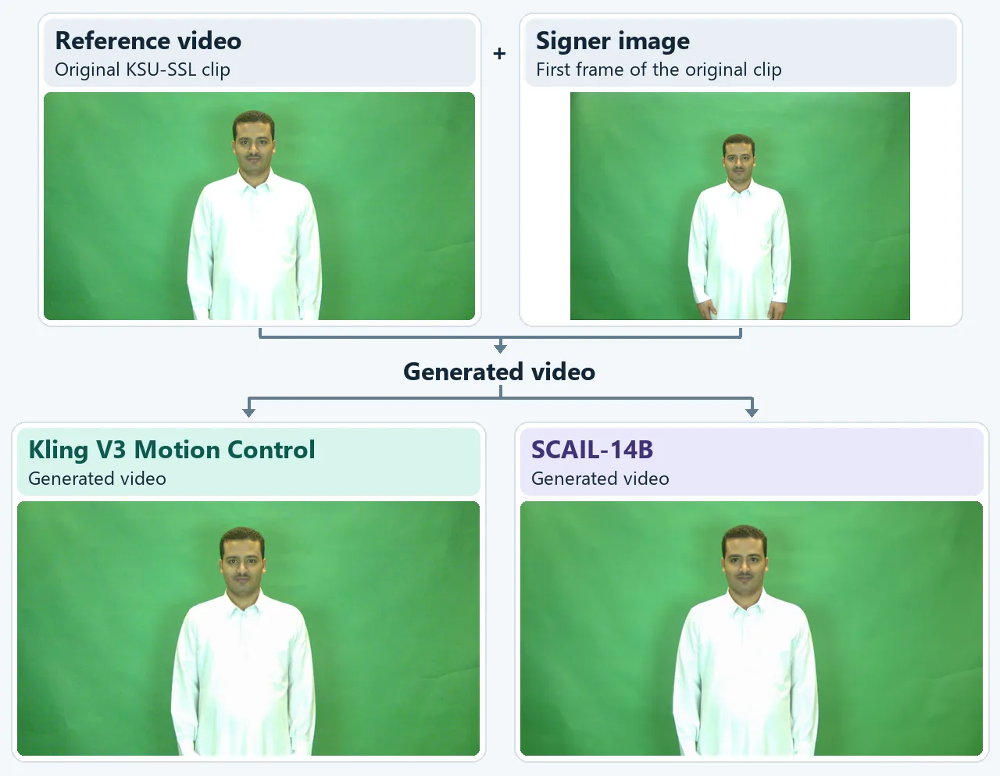
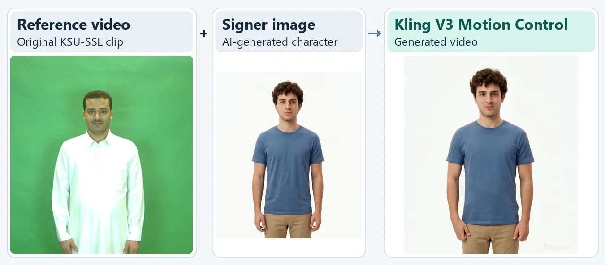
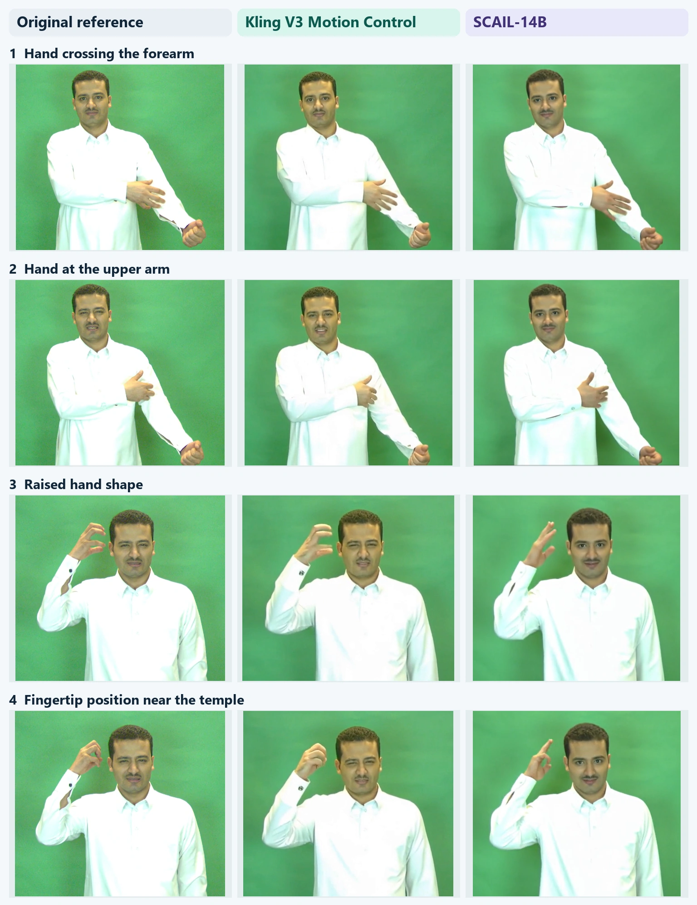

# Generative Video Augmentation for Sign Language Recognition | Jun 2026

 

At King Saud University’s [Center of Smart Robotics Research (CS2R)](https://www.cs2r.net/), we are working with the King Salman Center for Disability Research to expand a mixed-signer collection of approximately **7,000 Saudi signs**, with one recorded video per sign. We used **Kling 3.0 Motion Control** and **SCAIL-14B** to test whether generated repetitions and new signer appearances can improve recognition when training starts with one real clip per sign. A 293-video pilot drawn from KSU-SSL recreates that training setup on a smaller scale. [Saudi Sign Language Library](https://sshi.sa/)

**Preprint** · Soon &nbsp; | &nbsp; **Code** · Soon

## Dataset

The full King Saud University Saudi Sign Language dataset (KSU-SSL) contains **293 signs, 33 signers, and 145,035 samples** across 10 domains, including healthcare, everyday vocabulary, and the alphabet. The real-only training set contains **293 original RGB clips**, one per sign, drawn from repetition 1 across signers **18, 2, 24, 21, and 1**. [KSU-SSL dataset paper (Alsulaiman et al., 2023)](https://www.sciencedirect.com/science/article/pii/S1319157823001969?via%3Dihub)

## Augmentation approach

Both Kling 3.0 Motion Control and SCAIL-14B take two inputs: a **reference signing video** that supplies the motion and a **character image** that supplies the signer’s appearance. We carry the reference video’s sign label over to the generated clips.

- **Same signer.** Original video + image of the original signer → Kling or SCAIL → generated video counted as a **new repetition**.
- **Different signer.** Original video + image of a different person or a synthetic character → Kling or SCAIL → generated video counted as a **new signer example**.

### Demo clips

I am authorized to share the original KSU-SSL reference clip shown in these demos. The inline comparisons are framed around the signers. The source MP4 links provide the full frames.

#### Same signer, different angle

[Comparison MP4](assets/same-signer-inputs.mp4) · Original-quality clips: [Original](assets/original.mp4), [Kling V3](assets/kling-same-signer.mp4), [SCAIL-14B](assets/scail-same-signer.mp4)

#### Different signer

Kling V3 Motion Control receives the same signing video and the **AI-generated character image** shown in the demo. [View the character image at full size](assets/ai-generated-character.png).

[Comparison MP4](assets/different-signer-inputs.mp4) · [Original-quality Kling V3 clip](assets/kling-ai-signer.mp4)

#### Key frames showing pose differences

These four close-ups compare the original signer with the Kling and SCAIL outputs. The first two rows show hand placement along the arm. The last two show differences in finger shape and fingertip position near the temple.

## Recognition evaluation

The recognition model uses **spatial and temporal encoders with attention** to represent signing pose and motion across frames. The sample size is the total number of training videos. Each generated clip per sign adds 293 videos.

### Signer-dependent

Validation uses **repetition 2** and testing uses **repetition 3** from the same KSU-SSL signers as training.

| Training data | Sample size (real + generated) | Top-1 accuracy | Top-5 accuracy |
| --- | ---: | ---: | ---: |
| Real only | 293 (293 + 0) | 71% | 90% |
| Real + 1 Kling clip per sign (same signer) | 586 (293 + 293) | 83% | 97% |
| Real + 2 Kling clips per sign (same signer) | 879 (293 + 586) | 87% | 97% |
| Real + 1 SCAIL clip per sign | 586 (293 + 293) | 83% | 94% |
| Real + 1 Kling clip per sign (different signer) | 586 (293 + 293) | 78% | 92% |

### Signer-independent

Validation uses **repetition 1** from KSU-SSL signers **16, 19, 25, 26, and 29**. Testing uses **repetition 1** from signers **5, 6, 7, 9, and 30**.

| Training data | Sample size (real + generated) | Top-1 accuracy | Top-5 accuracy |
| --- | ---: | ---: | ---: |
| Real only | 293 (293 + 0) | 15% | 30% |
| Real + 1 Kling clip per sign (same signer) | 586 (293 + 293) | 22% | 40% |
| Real + 2 Kling clips per sign (same signer) | 879 (293 + 586) | 28% | 52% |
| Real + 1 SCAIL clip per sign | 586 (293 + 293) | 19% | 38% |
| Real + 1 Kling clip per sign (different signer) | 586 (293 + 293) | 24% | 51% |
| Real + 5 Kling clips per sign (different signer) | 1758 (293 + 1465) | 40% | 74% |

## Hardware and generation time

Generated clips averaged about **4 seconds**. Local generation used an **NVIDIA GeForce RTX 3090 with 24 GB VRAM**. Kling ran through its hosted API.

| Generator | Execution | Generated videos | Approx. batch time |
| --- | --- | ---: | ---: |
| [Kling 3.0 Motion Control](https://kling.ai/app) | Hosted API | 293 | 2 hours |
| [SCAIL-14B Preview, 5-bit GGUF (Q5)](https://huggingface.co/vantagewithai/SCAIL-Preview-GGUF/tree/main) | Local RTX 3090 | 293 | 45 hours (estimate) |

We also ran [MimicMotion](https://github.com/Tencent/MimicMotion), [MagicAnimate](https://github.com/magic-research/magic-animate), and [Wan2.2](https://github.com/Wan-Video/Wan2.2) locally. Their outputs did not preserve the signing motion well enough for this study.

[Official SCAIL model card](https://huggingface.co/zai-org/SCAIL-Preview)
