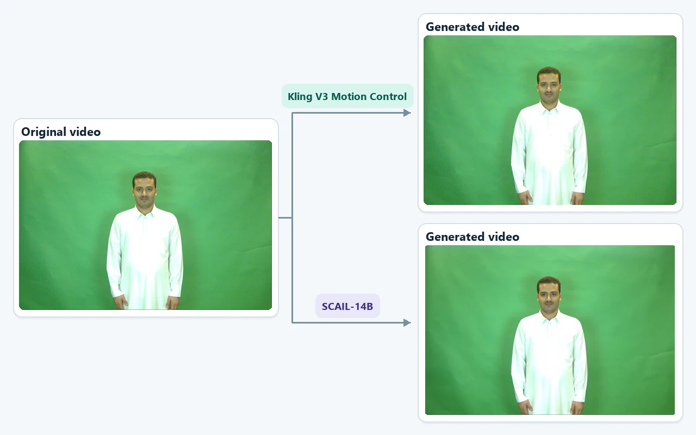
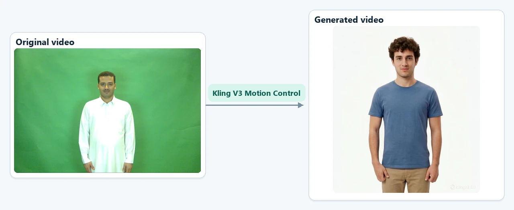

# Generative Video Augmentation for Sign Language Recognition

 

At King Saud University’s [Center of Smart Robotics Research (CS2R)](https://www.cs2r.net/), we are working with the King Salman Center for Disability Research to expand a mixed-signer collection of approximately **7,000 Saudi signs**, with one recorded video per sign. We used **Kling 3.0 Motion Control** and **SCAIL-14B** to test whether generated repetitions and new signer appearances can improve recognition when training starts with one real clip per sign. A 293-video pilot drawn from KSU-SSL recreates that training setup on a smaller scale. [Saudi Sign Language Library](https://sshi.sa/)

**Preprint** · Soon &nbsp; | &nbsp; **Code** · Soon

## Dataset

The full King Saud University Saudi Sign Language dataset (KSU-SSL) contains **293 signs, 33 signers, and 145,035 samples** across 10 domains, including healthcare, everyday vocabulary, and the alphabet. The real-only training set contains **293 original RGB clips**, one per sign, drawn from repetition 1 across signers **18, 2, 24, 21, and 1**. [KSU-SSL dataset paper (Alsulaiman et al., 2023)](https://www.sciencedirect.com/science/article/pii/S1319157823001969?via%3Dihub)

## Augmentation approach

An original signing video drives the motion in SCAIL-14B or Kling 3.0 Motion Control. A reference image determines the generated signer’s appearance. Both routes keep the original sign label.

- **Same signer.** Original video + image of the original signer → Kling or SCAIL → generated video counted as a **new repetition**.
- **Different signer.** Original video + image of a different person or a synthetic character → Kling or SCAIL → generated video counted as a **new signer example**.

### Demo clips

#### Same signer, different angle

[Comparison MP4](assets/demo-same-signer.mp4) · Original-quality clips: [Original](assets/original.mp4), [Kling V3](assets/kling-same-signer.mp4), [SCAIL-14B](assets/scail-same-signer.mp4)

#### Different signer

[Comparison MP4](assets/demo-different-signer.mp4) · [Original-quality Kling V3 clip](assets/kling-ai-signer.mp4)

## Recognition evaluation

The recognition model uses **spatial and temporal encoders with attention** to represent signing pose and motion across frames. The sample size is the total number of training videos. Each generated clip per sign adds 293 videos.

### Signer-dependent

Validation uses **repetition 2** and testing uses **repetition 3** from the same KSU-SSL signers as training.

| Training data | Sample size (real + generated) | Top-1 accuracy | Top-5 accuracy |
| --- | ---: | ---: | ---: |
| Real only | 293 (293 + 0) | | |
| Real + 1 Kling clip per sign | 586 (293 + 293) | | |
| Real + 2 Kling clips per sign | 879 (293 + 586) | | |
| Real + 1 SCAIL clip per sign | 586 (293 + 293) | | |
| Real + 2 Kling clips and 1 SCAIL clip per sign | 1,172 (293 + 879) | | |

### Signer-independent

Validation uses **repetition 1** from KSU-SSL signers **16, 19, 25, 26, and 29**. Testing uses **repetition 1** from signers **5, 6, 7, 9, and 30**.

| Training data | Sample size (real + generated) | Top-1 accuracy | Top-5 accuracy |
| --- | ---: | ---: | ---: |
| Real only | 293 (293 + 0) | | |
| Real + 1 Kling clip per sign | 586 (293 + 293) | | |
| Real + 2 Kling clips per sign | 879 (293 + 586) | | |
| Real + 1 SCAIL clip per sign | 586 (293 + 293) | | |

## Hardware and generation time

Generated clips averaged about **4 seconds**. Local generation used an **NVIDIA GeForce RTX 3090 with 24 GB VRAM**. Kling ran through its hosted API.

| Generator | Execution | Generated videos | Approx. batch time |
| --- | --- | ---: | ---: |
| [Kling 3.0 Motion Control](https://kling.ai/app) | Hosted API | 293 | 2 hours |
| [SCAIL-14B Preview, 5-bit GGUF (Q5)](https://huggingface.co/vantagewithai/SCAIL-Preview-GGUF/tree/main) | Local RTX 3090 | 293 | 45 hours (estimate) |

We also ran [MimicMotion](https://github.com/Tencent/MimicMotion), [MagicAnimate](https://github.com/magic-research/magic-animate), and [Wan2.2](https://github.com/Wan-Video/Wan2.2) locally. Their outputs did not preserve the signing motion well enough for this study.

[Official SCAIL model card](https://huggingface.co/zai-org/SCAIL-Preview)
