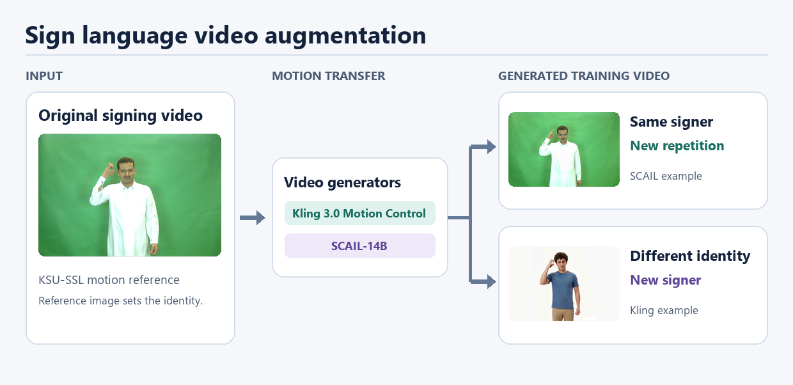
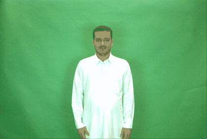
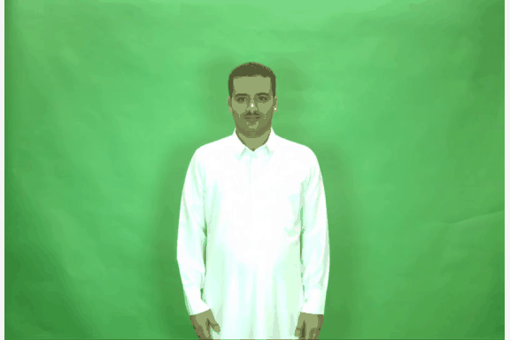
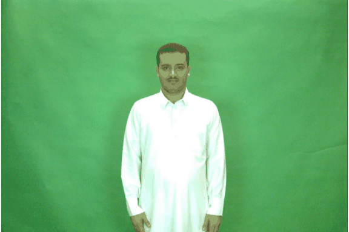
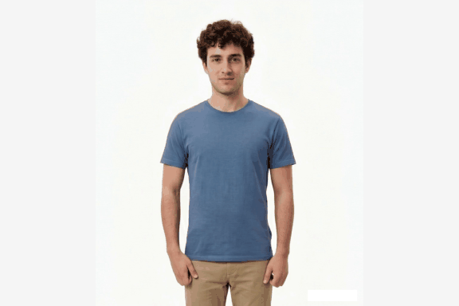

# Generative Video Augmentation for Saudi Sign Language Recognition

At King Saud University’s [Center of Smart Robotics Research](https://www.cs2r.net/) (CS2R), **Talal Aloushan** led an ongoing study with the King Salman Center for Disability Research on expanding a mixed-signer collection of approximately **7,000 Saudi signs**, with one recorded video per sign. We used **Kling 3.0 Motion Control** and **SCAIL-14B** to test whether synthetic repetitions and synthetic signer identities improve recognition when real training videos are scarce. The target collection is represented by the [Saudi Sign Language Library](https://sshi.sa/).

## Dataset

We used **293 original RGB training videos** from **KSU-SSL**, one per sign, drawn from five signers. This pilot reproduces the one-video-per-sign setup of the larger collection. The full KSU-SSL benchmark contains **293 signs, 33 signers, and 145,035 samples** across 10 domains, including healthcare, daily communication, and the alphabet. [KSU-SSL dataset paper (Alsulaiman et al., 2023)](https://www.sciencedirect.com/science/article/pii/S1319157823001969?via%3Dihub)

## Approach

An original signing video drives the motion. A reference image determines the generated signer’s appearance. We tested two ways to augment each sign class.

- **New repetition.** Keep the original signer’s identity and generate another performance of the same sign.
- **New signer.** Transfer the motion to a different reference identity and count the resulting clip as a synthetic signer example for that sign.

For downstream recognition, we used a custom model with **spatial and temporal encoders and attention**. The spatial encoder represents the signing pose, while the temporal encoder captures motion across frames.

### Demo clips

| Original motion reference | SCAIL-14B · Same signer |
| :---: | :---: |
|  |  |
| **Kling 3.0 · Same signer** | **Kling 3.0 · AI-generated signer** |
|  |  |

[Kling AI-generated signer demo (MP4)](assets/kling-ai-signer.mp4)

## Recognition evaluation

Training-set sizes show the total number of videos, with real and generated counts in parentheses.

### Signer-dependent

Training and validation share signer identities. Validation uses a separate real repetition of each sign. The test split uses a third real repetition from those signers.

| Training data | Training videos (real + generated) | Top-1 | Top-5 |
| --- | ---: | ---: | ---: |
| Real only | 293 (293 + 0) | | |
| Real + 1 Kling clip/sign | 586 (293 + 293) | | |
| Real + 2 Kling clips/sign | 879 (293 + 586) | | |
| Real + 1 SCAIL clip/sign | 586 (293 + 293) | | |
| Real + 2 Kling + 1 SCAIL clips/sign | 1,172 (293 + 879) | | |

### Signer-independent

Training and validation use disjoint real signer groups. The test split uses a third group of real signers.

| Training data | Training videos (real + generated) | Top-1 | Top-5 |
| --- | ---: | ---: | ---: |
| Real only | 293 (293 + 0) | | |
| Real + 1 Kling clip/sign | 586 (293 + 293) | | |
| Real + 2 Kling clips/sign | 879 (293 + 586) | | |
| Real + 1 SCAIL clip/sign | 586 (293 + 293) | | |
| Real + 5 Kling clips/sign | 1,758 (293 + 1,465) | | |

## Generation hardware and runtime

Local generation ran on an **NVIDIA GeForce RTX 3090 with 24 GB of VRAM**. Kling ran through its API. Generated videos averaged approximately **4 seconds** in the experiment batches.

| Generator | Execution | Generated videos | Approx. batch time |
| --- | --- | ---: | ---: |
| [Kling 3.0 Motion Control](https://kling.ai/app) | Hosted API | 293 | ~2 hours |
| [SCAIL-14B, 5-bit GGUF (Q5)](https://huggingface.co/vantagewithai/SCAIL-Preview-GGUF/tree/main) | Local RTX 3090 | 293 | ~45 hours (estimate) |

We also tested [MimicMotion](https://github.com/Tencent/MimicMotion), [MagicAnimate](https://github.com/magic-research/magic-animate), and [Wan2.2](https://github.com/Wan-Video/Wan2.2) locally. Their outputs did not preserve signing motion well enough in our trials. [Official SCAIL project](https://github.com/zai-org/SCAIL) · [Community SCAIL Pose Space (paused)](https://huggingface.co/spaces/John2J/SCAIL-Pose)

## Project status

The study is ongoing.

- **Preprint** — soon
- **Code** — soon
